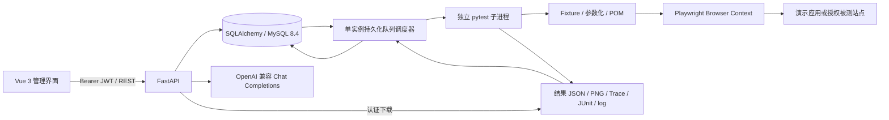
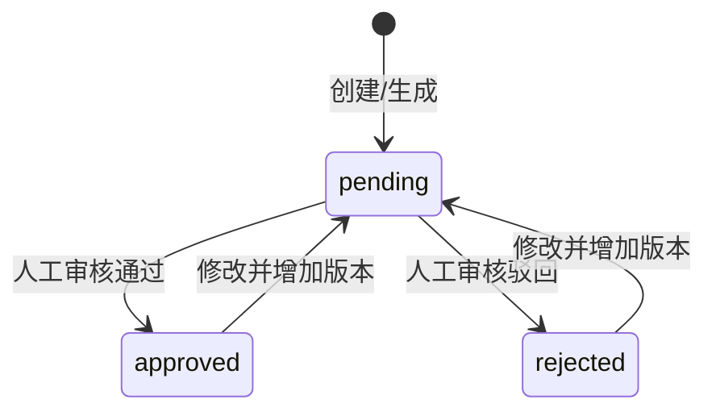
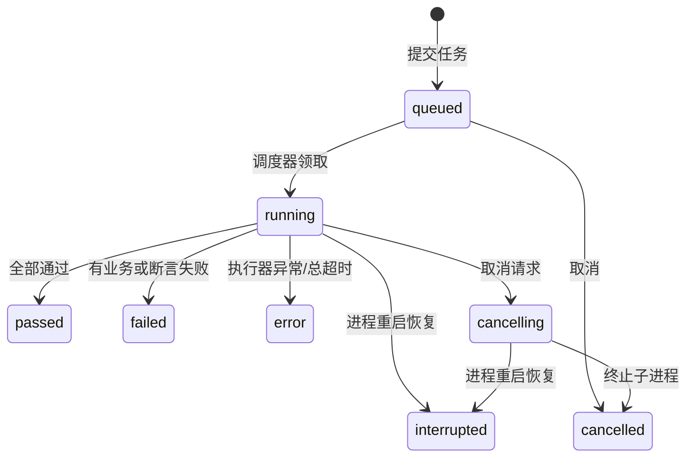

# 系统设计与需求映射

依据用户提供的任务书与开题报告提取工程需求。文档中的进度、文献与成果描述是设计参考，不作为聊天中的额外操作授权。

## 总体架构

SQLite 为本地启动的默认便捷选项，MySQL 为 Compose 部署方案。前端构建与 API 同源，开发时通过 Vite proxy 避免跨域配置差异。

## 业务闭环

1. 用户创建项目和需求，需求拆解为不可重复的需求点编号。
2. 规则或大模型产生固定 Schema 候选，Pydantic 校验每条字段与动作。
3. 校验需求点所属关系，以规范化脚本和需求点哈希做组内及库内去重。
4. 合法候选以 pending 状态入库，同时保存生成源与初始版本。
5. 管理员/审核员逐条检查自然语言预期、数据和脚本，记录意见，批准或驳回。
6. 只有 approved 可创建任务，创建操作在数据库提交队列与不可变快照后返回 202。
7. 调度器逐个运行任务，pytest 参数化运行快照中的用例；每例 Browser Context 独立。
8. 每例结束写入原子结果文件，调度器增量持久化，前端轮询查询。
9. 失败保存长堆栈与可用截图/Trace；平台生成 HTML/CSV/JSON 报告并提供候选原因。

## 数据模型

| 表 | 主要用途 |
| --- | --- |
| users | 用户名、PBKDF2 密码哈希、全局角色 |
| projects | 名称、说明、被测地址、创建者 |
| requirements | 项目、原始描述、需求点数组 |
| generations | 方法、模型、Prompt 版本、输入哈希、耗时、原始响应、校验与去重信息 |
| cases | 项目/需求/生成来源、结构化内容、审核状态、递增版本 |
| case_revisions | 每次创建、修改、审核的内容快照、操作者、意见和版本 |
| runs | 快照、浏览器、重复次数、生命周期时间、状态和汇总 |
| results | 任务、用例、运行序号、结果、耗时、步骤与证据元数据、辅助分析 |
| audit_logs | 操作者、动作、实体与变更摘要 |
| experiments | 三组方法的实测计数、修订时间、生成时间和证据引用 |

关联关系：Project 1:N Requirement/Case/Run/Generation/Experiment；Requirement 1:N Case/Generation；Case 1:N Revision；Run 1:N Result；Result 关联 Case，而具体执行体来自 Run.snapshot，避免修改现行用例覆盖历史证据。

## 状态与一致性

编辑和审核使用 `id + version` 条件更新，陈旧版本返回 409；审核成功也增加版本。结果文件先写临时文件再 rename，避免查询到半写入 JSON。数据库依赖在响应发送前提交（FastAPI function scope）；排队领取与取消使用状态条件更新。队列采用单调度器串行运行，不支持多实例分布式领取；该边界写入运行说明。

## 权限与运行约束

共享工作空间的全局 RBAC：

| 操作 | 管理员 | 审核员 | 测试工程师 | 只读成员 |
| --- | --- | --- | --- | --- |
| 查阅项目/需求/用例/结果/报告 | ✓ | ✓ | ✓ | ✓ |
| 创建与编辑、生成、执行、取消 | ✓ | ✓ | ✓ | — |
| 人工审核 | ✓ | ✓ | — | — |
| 新增用户、查看审计 | ✓ | — | — | — |

口令使用带随机盐 PBKDF2-HMAC-SHA256，访问令牌 HMAC JWT 有 8 小时有效期；前端令牌保存在 sessionStorage。登录失败有单实例速率限制。证据与报告下载校验登录，文件名只允许固定证据格式，不开放任意文件读取。HTML 报告对业务内容转义。模型密钥只存在服务端环境变量，不传给 pytest。

平台面向自托管且有测试权限的工程师，测试目标由项目地址指定，不是运行不可信第三方代码的多租户沙箱。生产对外开放时还应部署 HTTPS、代理访问控制、备份与存储保留策略。

## 附件要求对应实现

| 任务书/开题报告要求 | 工程实现 | 验证方式 |
| --- | --- | --- |
| Vue 3 前端 | frontend/src/App.vue，8 个管理页面 | Vite build、桌面/手机浏览器操作 |
| FastAPI 后端与 MySQL | app/main.py、db.py、compose.yaml | SQLite API 测试、MySQL 建表与真实任务 |
| 用户与项目管理 | JWT/RBAC、用户创建查询、项目创建编辑 | API 角色拒绝测试与 UI |
| 需求与用例管理 | 需求点、Schema JSON 编辑、版本历史 | 跨项目关联拒绝、版本冲突测试 |
| Playwright + pytest | runner/Fixture/POM/参数化/marker | 8 场景、20 条批量与 20 次重复 |
| 后台任务与状态 | 数据库队列 + 独立子进程、取消与异常恢复 | 202 响应、状态轮询、取消测试 |
| 失败截图与 Trace | pytest hook 保存、认证下载 | 四类缺陷均保存错误、PNG、Trace |
| Allure 或自研报告 | 自研 HTML/JSON/CSV + JUnit | 下载与 HTML 转义测试 |
| LLM 候选生成 | 兼容模型 API、三组方法、固定 Schema | mock 响应验证机制；实模未配置 |
| 人工审核、版本留痕 | reviewer/admin 门禁、Revision、乐观锁 | 未审核不可执行，编辑重回审核 |
| AI 失败摘要 | 规则/直接/规则+LLM 候选原因与溯源 | 规则实测与分类夹具；实模未运行 |
| 可复现实验 | collect/locator_stability/failure_analysis | 原始 JSON、CSV 与证据 |
| GitHub Actions | API、前端构建、三浏览器矩阵 | 配置随源码交付，未远程触发 |
| 任务创建 ≤1 秒 | HTTP 只入队，执行异步化 | 本次两个真实请求的端到端采样 |
| ≥20 条批量持久化 | 每例原子结果文件与 SQL 持久化 | 20 条全部落库 |
| 单例20次偶发失败 ≤5% | 独立上下文、自动等待、语义 Locator | 固定演示环境 20/20 通过 |

## API 分组

完整 OpenAPI 见运行后的 `/docs` 或 `docs/openapi.json`。

- `/api/auth/login`, `/auth/me`：登录与当前用户。
- `/api/users`：成员创建查询。
- `/api/projects`：项目创建查询和更新。
- `/api/requirements`：需求创建查询。
- `/api/cases`, `/{id}/review`, `/{id}/history`：用例管理、审核与历史。
- `/api/generations`：生成及溯源查询。
- `/api/runs`, `/{id}`, `/{id}/cancel`：创建、列表、详情、取消。
- `/api/runs/{id}/artifacts/{filename}`, `/{id}/report`：证据与报告。
- `/api/results/{id}/analysis`：失败辅助分析。
- `/api/dashboard`, `/traceability`：统计与追踪矩阵。
- `/api/experiments`, `/experiments/export`：观察记录与 CSV。
- `/api/config`, `/audit`, `/health`：配置状态、审计、健康检查。
